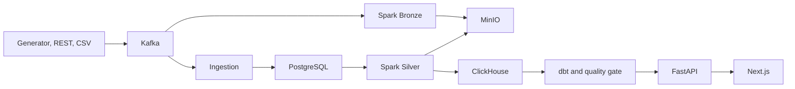

# TITAN

TITAN is a local commerce data platform. It answers a narrow question: which synthetic orders were accepted, in which currency, and which published snapshot is safe to show.

Events are generated, posted over REST, or uploaded as CSV. They move through Kafka, a PostgreSQL classification, Spark Bronze and Silver on MinIO, a versioned ClickHouse warehouse, dbt tests, and a blocking quality gate. Dagster orders that publication. FastAPI and a Next.js console read the snapshot that both databases agree on.

The data is synthetic. Delivery is at-least-once with idempotent persistence. It is not end-to-end exactly-once.

## What it demonstrates

- Multi-source ingestion, quarantine, duplicate delivery, and business-key conflicts
- Offset commit after a durable PostgreSQL write
- Bronze evidence that is invisible until a commit row exists
- Versioned Silver and a ClickHouse publication exchanged only after dbt and quality checks
- Currency-separated revenue, with no cross-currency sum
- Baseline-aware forecasting: seasonal naive is served because its held-out MAE was lower
- A recovery decision that requires quality, dbt, Silver lineage, and matching fact counts
- A measured producer-acknowledgement sample, labeled as that and nothing broader

## Architecture



Dagster orders Silver, the ClickHouse load, dbt, the quality gate, and the pointer exchange. It does not transform rows. Details and the guarantee table are in [docs/portfolio/architecture.md](docs/portfolio/architecture.md).

| Piece | Responsibility |
| --- | --- |
| `packages/contracts` | Event envelope and money rules |
| `packages/store` | Operational tables and migrations |
| `services/ingestion` | Consume, classify, then commit |
| `pipelines/spark` | Bronze and Silver |
| `pipelines/warehouse` | ClickHouse load, exchange, reconcile |
| `warehouse/dbt` | Models and tests |
| `pipelines/dagster` | Asset order and schedules |
| `pipelines/quality` | Blocking publication checks |
| `pipelines/ml` | Demand training and the serving choice |
| `apps/api`, `apps/web` | Read models and the operations console |

## Quick start

Windows, Docker Desktop, Python 3.12, [uv](https://docs.astral.sh/uv/) 0.12.x, and Node.js 20.9 or newer. Give Docker at least 8 GB. The Compose limits are Kafka 768 MiB, PostgreSQL 512 MiB, MinIO 256 MiB, ClickHouse 1536 MiB, Spark 1536 MiB, ingestion 512 MiB, API 512 MiB, and web 768 MiB.

```powershell
copy .env.example .env
docker compose up --build -d
docker compose run --rm --build migrate
uv sync --all-packages
uv sync --group orchestration
uv run python scripts/verify_infrastructure.py
```

The API is http://localhost:8000 and the console is http://localhost:3000. Profiles: `generate` for the containerized producer, `processing` for Spark, `orchestration` for the optional Dagster daemon. The daemon is off by default so the hourly warehouse job does not publish on its own.

```powershell
docker compose down
```

That stops containers and keeps the named volumes. Do not add `-v` unless you intend to delete PostgreSQL, Kafka, MinIO, and ClickHouse data.

Set `TITAN_ADMIN_TOKEN` in `.env` and recreate the API before replay or CSV resume. An empty token makes those two calls return 401. REST publication and CSV upload stay open on localhost. This is a workstation boundary, not a public deployment.

Pinned images and the money rules are in [docs/local-infrastructure.md](docs/local-infrastructure.md) and [docs/money-policy.md](docs/money-policy.md).

## Demo

```powershell
uv run python scripts/demo_day7.py
```

The walkthrough is [DEMO.md](DEMO.md). The last successful run published warehouse `50d22fe5-8db0-4f2f-bc00-47bda48152fc` with 362 accepted orders: EUR 18711.58, GBP 16558.03, USD 17768.77. The order it added was `ord_54943729demo` at EUR 19.95. The larger jump from the earlier 259-order snapshot includes accepted rows that had been stored in PostgreSQL and not yet published.

`GET /api/v1/warehouse/status` after that run reported `ready: true` for that publication. The serving forecast remained `seasonal_naive` on run `3a3f7264-818c-4e85-9b56-4793d68157ef`, trained from publication `a44926d4-0d7d-4a30-857d-d543341475a0`.

## Verification

```powershell
uv run ruff check
uv run ruff format --check
uv run mypy
uv run pytest -m "not integration"
uv run python scripts/scan_secrets.py
docker compose --profile processing run --rm --no-deps spark-tests
uv run --group orchestration dbt build --no-partial-parse --project-dir warehouse/dbt --profiles-dir warehouse/dbt
$env:DAGSTER_HOME = (Resolve-Path pipelines/dagster/home)
$env:PYTHONPATH = "pipelines/warehouse/src;pipelines/quality/src;pipelines/ml/src;pipelines/dagster/src"
uv run --group orchestration dagster definitions validate -w pipelines/dagster/workspace.yaml
```

Live scripts, each of which needs the stack:

```powershell
uv run python scripts/verify_day7.py
uv run python scripts/demo_day7.py
```

`verify_day7.py` stops Kafka, checks that the warehouse status stays ready, starts Kafka, and runs reconcile. Day 2 through Day 6 scripts remain in `scripts/` for the earlier milestones.

GitHub Actions runs ruff, mypy, unit tests, the secret scan, Dagster definition validation, and the web build. A green hosted run is not claimed until one exists for the commit you are reading.

## Benchmark

`scripts/benchmark_ingestion.py` writes `benchmarks/day7-<count>.json`. The default count is 100. The 5,000-event sample below used an isolated topic so it would not create accepted orders.

```powershell
$env:TITAN_BENCH_COUNT = "5000"
$env:TITAN_BENCH_SEED = "71022"
uv run python scripts/benchmark_ingestion.py
```

Measured at `2026-11-22T17:31:28.666544+00:00` on an AMD Ryzen 7 9800X3D with 32 GB of RAM. Docker Desktop showed about 13.65 GiB for containers without an explicit limit. Other local containers were running. Kafka was 337 MiB of 768 MiB before the sample and 375 MiB after.

| Scope | Result |
| --- | --- |
| Topic | `titan.benchmark.acks` |
| Records | 5000, seed 71022 |
| Elapsed | 4.22 s |
| Acknowledged / second | 1184.964 |
| Ack p50 / p95 / p99 | 0.000598 s / 0.000843 s / 0.001013 s |
| `logical_orders` | 360 before and after |
| Ingestion lag | 0 before and after |

This is producer acknowledgement time. It is not warehouse freshness, not HTTP latency, and not a production capacity figure. An earlier 100-event sample on the commerce topics is in `benchmarks/day6-100.json` and did enter PostgreSQL. Do not describe either sample as sustained end-to-end throughput.

## Forecasts and security

Training uses daily quantity per product. The last seven dates are the test week. One-step rows use earlier actuals. The forward week is recursive and does not read a future actual. The gradient-boosting candidate is served only when its MAE is strictly lower. Otherwise the label is `seasonal_naive`, and the candidate stays in `ml_runs`. See [docs/quality-ml.md](docs/quality-ml.md).

Recovery, offset rules, and the admin token are in [docs/reliability.md](docs/reliability.md).

## Known limits

- Synthetic data only. No claim about a real catalog or a real store.
- No public-internet authentication. Admin replay and CSV resume are fail-closed. Ingestion ports are still open on the workstation.
- Spark JVM `kill -9`, a live two-member rebalance, and a MinIO outage during a write were not executed.
- The console was not exercised in a browser in the Day 7 session. HTTP responses return the client loading shell. A capture list is in [docs/portfolio/screenshots.md](docs/portfolio/screenshots.md).
- The hourly Dagster schedule is defined and left stopped.

## Portfolio notes

Short descriptions for a resume, a case study, and a demo narration are in [docs/portfolio](docs/portfolio).
