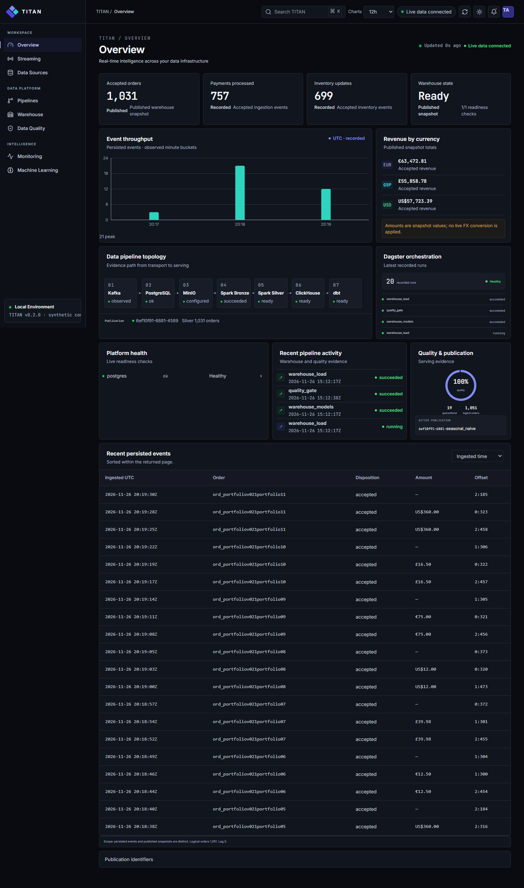
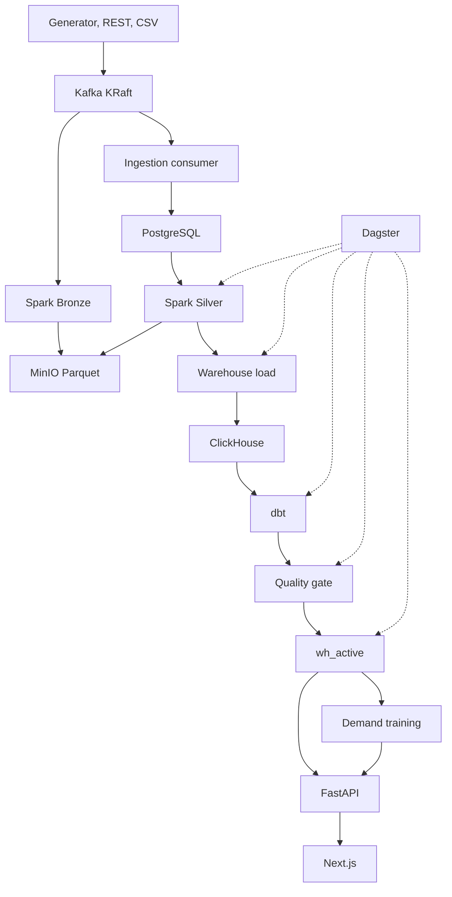
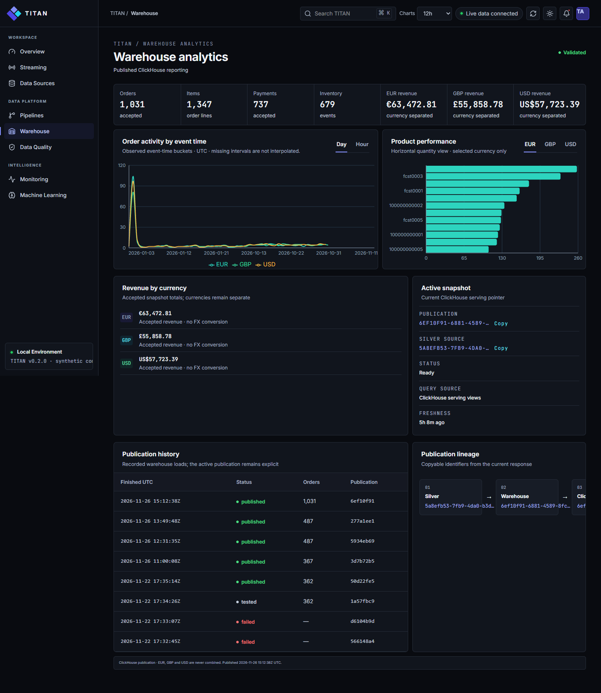
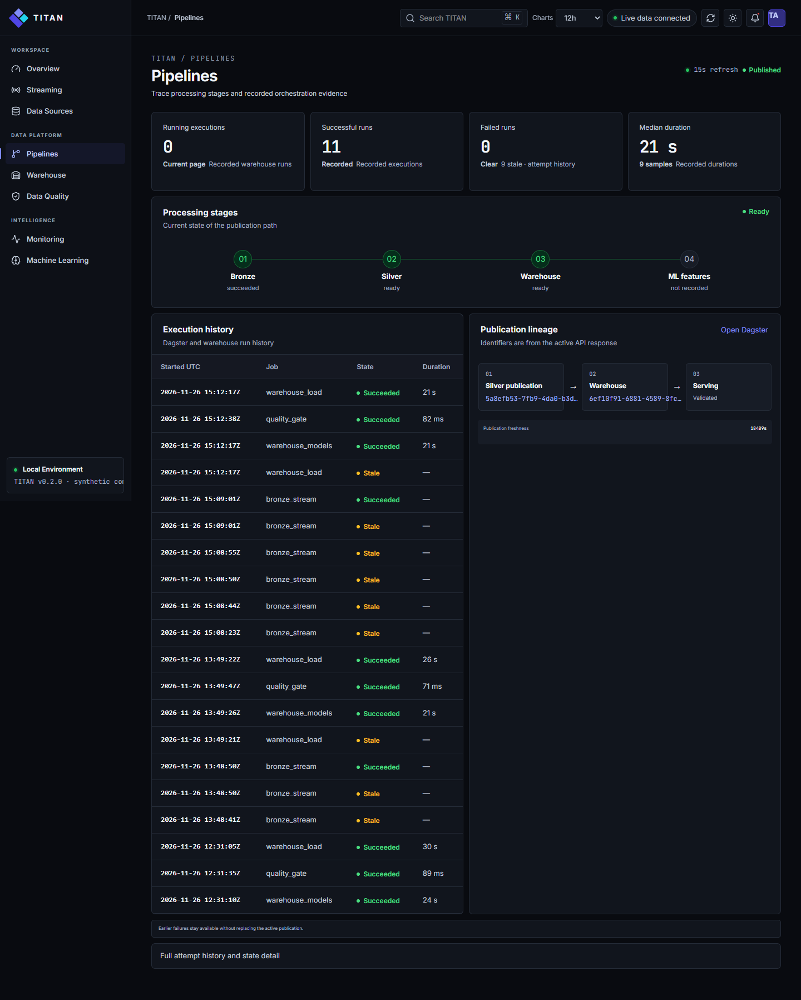
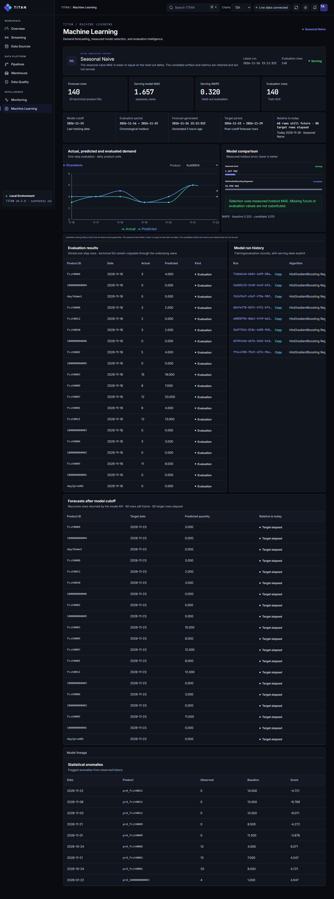
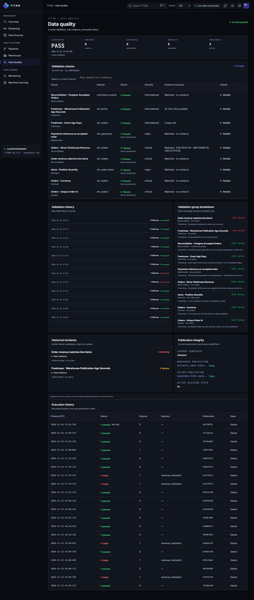
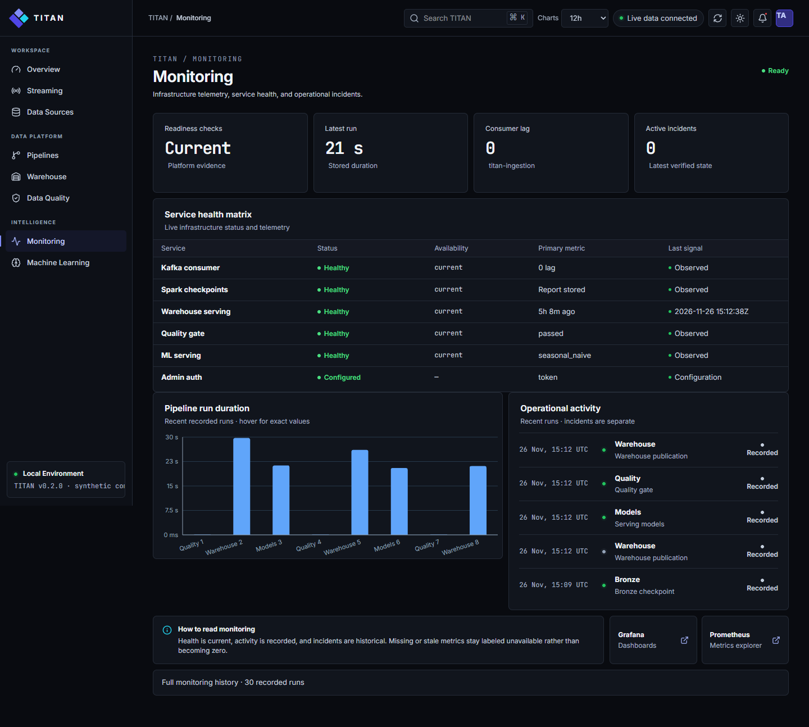
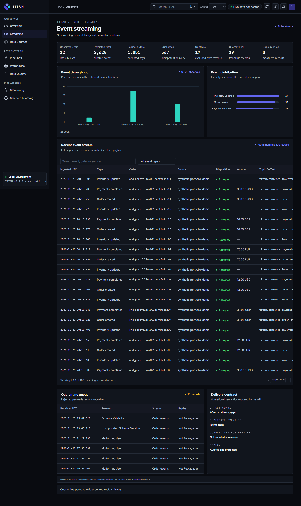
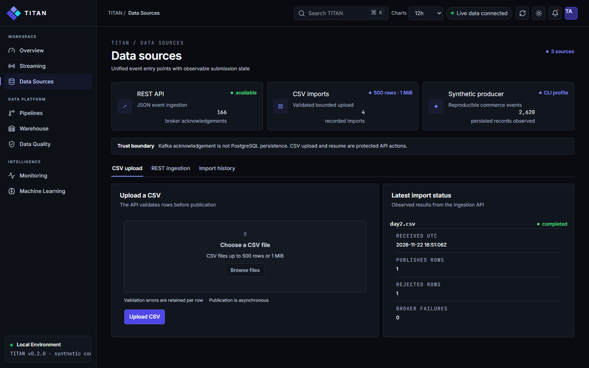

# TITAN — Real-Time Data Intelligence Platform

[](https://github.com/Ibrahem-Ali-99/TITAN/actions/workflows/ci.yml)

A commerce report is only useful when it names the orders that were accepted, the currency of each amount, and the one snapshot that is safe to show. TITAN takes synthetic orders, payments, and inventory events from a generator, REST, or CSV, classifies them once, and serves analytics only from the warehouse publication that PostgreSQL and ClickHouse still agree on. dbt and a blocking quality gate run before that publication changes.

The events are synthetic. Delivery is at-least-once with idempotent persistence. It is not end-to-end exactly-once. The running system is one workstation Compose project, not a production deployment. That boundary is [below](#portfolio-scale-and-production-readiness).

TITAN v0.2.1 preserves the existing API contracts while adding the grouped TITAN
operations shell, responsive layouts, theme control, and live-data states across
all eight console screens. Release evidence, acceptance limits, and local
interface URLs are in [docs/releases/v0.2.1-monitoring-acceptance.md](docs/releases/v0.2.1-monitoring-acceptance.md)
and the [release audit](docs/audits/v020-final-release-candidate.md).



The demonstration data is synthetic and runs locally in one workstation Compose
project. The complete dark/light desktop and mobile capture set is in
[the v0.2.1 portfolio archive](docs/assets/titan-v0.2.1-portfolio-screenshots.zip) and
[`docs/assets/v021-portfolio`](docs/assets/v021-portfolio), with capture
metadata and route assertions alongside the images. Notes: [docs/portfolio/screenshots.md](docs/portfolio/screenshots.md).

## Capabilities

- Generator, REST, and CSV publish one envelope. The consumer is the only writer of `commerce_events`.
- The Kafka offset is committed after the PostgreSQL insert or the quarantine insert. The same `event_id` does not become a second accepted order. A conflicting business payload is stored and excluded from revenue.
- Bronze stays unreadable until `bronze_batch_commits` exists. Silver is built from the PostgreSQL classification, not from arrival order.
- ClickHouse keeps every staged load. Readers see the one `wh_active` publication, and only after dbt and the quality gate.
- Revenue stays decimal and separated by currency.
- Demand training serves `hist_gradient_boosting` only when its held-out MAE is strictly lower. On this publication the served label is `seasonal_naive`. The candidate artifact remains.
- Recovery requires a passing quality run, a successful dbt run, published Silver lineage, and matching fact counts.

Paths and guarantees: [docs/architecture.md](docs/architecture.md), [docs/portfolio/architecture.md](docs/portfolio/architecture.md).

## Architecture



Solid arrows are data. Dotted arrows are job order. Dagster does not transform rows. Spark writes Bronze from Kafka and Silver from PostgreSQL dispositions. Spark does not write `commerce_events`. Quality checks and demand training read a warehouse publication and write their own metadata.

| Layer | Pin |
| --- | --- |
| Runtime | Python 3.12, uv 0.12.1, Node.js 26.13.1 |
| Contract and client | Pydantic 2.14.4, confluent-kafka 2.16.2 |
| Transport | Apache Kafka 4.4.0, KRaft, one broker |
| Operational store | PostgreSQL 18.7, SQLAlchemy 2.1.9, Alembic 1.20.1, psycopg 3.3.9 |
| Lake | Spark 4.0.1 on Java 21, MinIO `alpine/minio:RELEASE.2025-10-15T17-29-55Z` |
| Warehouse | ClickHouse 26.8.36.3, dbt-core 1.12.7, dbt-clickhouse 1.10.3 |
| Orchestration | Dagster 1.13.31, daemon off unless the `orchestration` profile is started |
| Forecasts | scikit-learn 1.7.2 |
| Serving | FastAPI 0.165.0, Uvicorn 0.54.0, Next.js 16.4.6, React 19.3.0 |
| Checks | Ruff 0.17.6, mypy 2.4.1, pytest 9.2.0, [`.github/workflows/ci.yml`](.github/workflows/ci.yml) |

Redis, Kubernetes, and a schema registry are not in this repository. Ingestion, the lake, publication, forecasts, and monitoring are specified in [docs/consumption-semantics.md](docs/consumption-semantics.md), [docs/ingestion-hub.md](docs/ingestion-hub.md), [docs/spark-lake.md](docs/spark-lake.md), [docs/warehouse.md](docs/warehouse.md), [docs/quality-ml.md](docs/quality-ml.md), and [docs/reliability.md](docs/reliability.md).

## Verified reliability

These runs were executed and written down. They were not repeated for this README.

**Idempotent consumption.** Producer idempotence covers broker retries only. There is no transaction across Kafka and PostgreSQL. A crash between the database write and the offset commit redelivers the record. The `event_id` primary key keeps that from becoming another accepted order.

**Spark checkpoint recovery.** The checkpoint is a local volume because an S3A directory rename is not a safe commit. On 2026-11-22 an isolated project SIGKILLed the Bronze driver after the Parquet copy and before the batch commit. Restart wrote one commit for those 9 records. PostgreSQL and ClickHouse then agreed on 5 accepted orders, 10 line items, and the same three currency sums. The development database stayed at 362 accepted orders. [docs/audits/spark-crash-recovery.md](docs/audits/spark-crash-recovery.md).

**Publication consistency.** `wh_active` and the PostgreSQL load row are not one transaction. The API reports `ready: false` and withholds analytics when those ids disagree, or when the active id lacks a passing quality run, a successful dbt run, published Silver lineage, or matching fact counts. An injected revenue mismatch left the previous publication serving. The clean run published `50d22fe5-8db0-4f2f-bc00-47bda48152fc`.

**Reconciliation.** `python -m titan_warehouse --reconcile` points `wh_active` at the newest verified publication and does not copy the facts again. If nothing is verified, the pointer stays. On the isolated end-to-end project, a crash after the ClickHouse exchange left the API not ready. After the fix, reconcile restored `0e171bf1-0d3f-4c2f-bb7c-9f23f4d9287b` with 11 orders and the same currency sums. [docs/audits/end-to-end-reliability.md](docs/audits/end-to-end-reliability.md).

## Console

The same capture, in the order a reader meets the product: the published warehouse, the publication path, the serving forecast, the quality gate, monitoring, streaming, and intake.















## Quick start

Windows PowerShell, Docker Desktop with at least 8 GB of memory, Python 3.12, and [uv](https://docs.astral.sh/uv/) 0.12.x. The images pin uv 0.12.1. Host Node.js is required only for npm commands outside Docker. The web image and the web CI job use Node.js 26.13.1.

```powershell
copy .env.example .env
docker compose up --build -d
docker compose run --rm --build migrate
uv sync --all-packages
uv sync --group orchestration
uv run python -m scripts.verify_infrastructure
```

The API is http://localhost:8000 and the console is http://localhost:3000. `docker compose down` stops the containers and keeps the volumes. Memory limits, the isolated checkout, local check commands, and troubleshooting are in [docs/local-infrastructure.md](docs/local-infrastructure.md).

A new database has no publication. From the same shell:

```powershell
uv run python -m event_generator --history-days 28 --seed 51022 --rate 0
docker compose --profile processing run --rm spark-bronze
docker compose --profile processing run --rm spark-silver
uv run --group orchestration python -m scripts.run_pipeline titan_warehouse
uv run --group orchestration python -m scripts.run_pipeline titan_ml
```

Wait until `GET /api/v1/warehouse/status` reports `"ready": true`. `titan_ml` serves `seasonal_naive` unless the candidate MAE is strictly lower.

```powershell
uv run python -m scripts.demo_day7
```

The script adds one order to a warehouse that is already ready and leaves the serving forecast in place. Walkthrough: [DEMO.md](DEMO.md). Narration: [docs/portfolio/demo-script.md](docs/portfolio/demo-script.md).

## Observability

The observability profile is optional. `docker compose up -d` does not start it.

```powershell
docker compose --profile observability up -d
```

Prometheus is http://127.0.0.1:9090. Grafana is http://127.0.0.1:3001, user `titan`, with the same local password placeholder as the databases. Request tracing stays off until `OTEL_ENABLED=1` and the API container is recreated. The Next.js Monitoring page is unchanged. Setup, metrics, alerts, and the verification record are in [docs/observability.md](docs/observability.md).

Dagster is available as the orchestration runtime when its profile is enabled, but this local release does not publish a Dagster webserver on port 3002. Use the TITAN Pipelines and Monitoring screens, the Dagster daemon logs, and the documented API evidence for pipeline status; an absent Dagster browser UI is an intentional local deployment limitation.

## Evidence

Each figure names the run that produced it.

### Hosted CI

[`.github/workflows/ci.yml`](.github/workflows/ci.yml) runs on push and pull request. The `python` job uses frozen uv 0.12.1 and Python 3.12 for Ruff, mypy, `pytest -m "not integration"`, the secret scan, and `pip-audit` 2.10.1. The `orchestration` job validates Dagster definitions. The `web` job uses Node.js 26.13.1 for `npm ci`, `npm audit`, tests, lint, typecheck, and `next build`. Permissions are `contents: read`.

On `master`, the hosted runs for [`e1ba23e`](https://github.com/Ibrahem-Ali-99/TITAN/actions/runs/45079314376), [`bbd6a2d`](https://github.com/Ibrahem-Ali-99/TITAN/actions/runs/45080449906), and [`49f9737`](https://github.com/Ibrahem-Ali-99/TITAN/actions/runs/45082135654) completed successfully on 2026-11-22. The first push, [`5b30029`](https://github.com/Ibrahem-Ali-99/TITAN/actions/runs/45078387497), failed, and the later commits fixed that workflow. The badge follows the default branch. A commit that is not yet pushed has no hosted run.

### Workstation suites

Recorded in [docs/audits/release-candidate-verification.md](docs/audits/release-candidate-verification.md) and [docs/audits/end-to-end-reliability.md](docs/audits/end-to-end-reliability.md).

| Check | Result | Where |
| --- | --- | --- |
| Ruff, format, mypy, secret scan | Passed. mypy reported 84 files. Format reported 138 files | Workstation, after the secret-scan fix |
| `pytest -m "not integration"` | 61 passed, 1 deselected | Same workstation run |
| `pytest -m integration` | 1 passed, 55 deselected | Isolated project `titan-e2e` |
| Spark image tests | 11 passed in 31.70 s | `titan-e2e` |
| dbt with `TITAN_DBT_GATE=fail` | `PASS=21 ERROR=1`. The pointer did not move | `titan-e2e` |
| `dagster definitions validate` | Validation successful | Candidate checkout `6ebd47d` |
| Web `npm test`, lint, typecheck, audit, build | 10 tests passed, 0 npm audit findings, Next.js 16.4.6, 11 routes | Candidate `6ebd47d`, web container |
| axe-core 4.10.3 | No violations on eight routes at 1440×900, 1024×768, 768×1024, and 390×844 | `http://localhost:3000` after the console restart |
| `pip-audit` 2.10.1 | No known vulnerabilities in the frozen third-party export | Same release-candidate pass |

`pytest -m integration` was not repeated after that isolated run. The audits still call the overall release conditional because a two-member Kafka rebalance and a MinIO outage during a write were not executed.

### Measurements

Producer acknowledgements from [`benchmarks/day7-5000.json`](benchmarks/day7-5000.json), measured `2026-11-22T17:31:28.666544+00:00` on an AMD Ryzen 7 9800X3D with 32 GB of RAM. Docker Desktop showed about 13.65 GiB for containers without an explicit limit. Other local containers were running. Kafka was 337 MiB of 768 MiB before the sample and 375 MiB after.

| Scope | Result |
| --- | --- |
| Topic | `titan.benchmark.acks` |
| Records | 5000, seed 71022 |
| Elapsed | 4.22 s |
| Acknowledged / second | 1184.964 |
| Ack p50 / p95 / p99 | 0.000598 s / 0.000843 s / 0.001013 s |
| `logical_orders` | 360 before and after |
| Ingestion lag | 0 before and after |

Ingestion does not consume that topic. This is producer acknowledgement time. It is not warehouse freshness, not HTTP latency, and not a capacity figure. An earlier 100-event sample in [`benchmarks/day6-100.json`](benchmarks/day6-100.json) did enter PostgreSQL. Neither sample is sustained end-to-end throughput.

API wall clock from the [final engineering audit](docs/audits/final-engineering-audit.md), 10 sequential `Invoke-RestMethod` calls on the same development stack:

| Endpoint | min | p50 | max |
| --- | --- | --- | --- |
| `GET /api/v1/warehouse/status` | 30 ms | 32 ms | 85 ms |
| `GET /health/ready` | 46 ms | 48 ms | 52 ms |

That audit reconciled the serving snapshot: PostgreSQL and ClickHouse both had 362 orders, 540 items, 193 payments, and the three currency sums above. `wh_orders` without the publication filter was 6517 because earlier staged loads remain in the table.

The recorded demo, [`benchmarks/demo-day7.json`](benchmarks/demo-day7.json), added `ord_54943729demo` at EUR 19.95 and moved the serving publication from `a44926d4-0d7d-4a30-857d-d543341475a0` to `50d22fe5-8db0-4f2f-bc00-47bda48152fc`. The serving forecast stayed `seasonal_naive` on run `3a3f7264-818c-4e85-9b56-4793d68157ef`, trained on the earlier 259-order publication. Candidate MAE was 2.5971 and seasonal-naive MAE was 1.469388 on 49 test rows. The console rounds those MAE values to three decimals.

A clean clone on project `titan-clone` published a different snapshot, `9cb0b695-4327-4ad5-b3db-f8a008177862`, with 187 orders, and served `hist_gradient_boosting` because that candidate beat the baseline on that history. Development orders stayed 362. [docs/audits/clean-clone-release.md](docs/audits/clean-clone-release.md).

## Portfolio scale and production readiness

The checks show that this path can classify events, recover a killed Spark batch, refuse a bad publication, and serve one agreed snapshot. They do not show a production deployment.

| Present in this repository | Not established |
| --- | --- |
| One Kafka broker, replication factor 1, workstation ports | A multi-broker cluster, or a live two-member rebalance |
| Local placeholder passwords in Compose and `.env.example` | Credential rotation, network policy, or public authentication |
| Admin replay and CSV resume fail closed when the token is empty. REST and CSV upload stay open on localhost | An ingestion surface that is safe on the public internet |
| Next.js development server in Compose. `next build` runs in CI | A deployed console |
| Dagster daemon off by default. The profile mounts the Docker socket so scheduled jobs can launch Spark | An unattended production scheduler |
| MinIO community image running as `user: "0:0"` so a named volume can initialize | A production object store or a hardened image |
| One 5,000-record producer-ack sample and a 10-call API latency sample | Capacity, cost, or a soak test |
| Optional localhost Prometheus, Grafana, and trace profile | A production on-call system or a measured SLO |
| Synthetic customers, products, and demand | A real catalog or a measured business result |
| Hosted CI green for the commits named above | A release sign-off. The audits remain conditional on the gates they mark unverified |

A green GitHub Actions run checks this repository. It does not promote the workstation stack to production.

## Decisions and limits

- Offset commit follows a durable PostgreSQL write. There is no distributed transaction across Kafka, PostgreSQL, MinIO, and ClickHouse.
- Bronze is invisible to readers until its commit row exists. A partial prefix is not a completed batch.
- An older Silver snapshot cannot replace a warehouse built from a later one.
- The gradient-boosting hyperparameters are fixed. They are not searched against the test week.
- Historical `pipeline_runs` rows that recorded `running` with a finish time were left in place. Monitoring does not call them recovered.
- The web container runs `next dev`. Commit [`bbd6a2d`](https://github.com/Ibrahem-Ali-99/TITAN/commit/bbd6a2d0b7a74fe7f0236dd6b732fe55bca026e0) closed the two warnings recorded in the earlier audits: `httpx2` is installed for Starlette's `TestClient`, and the web package sets `"type": "module"`.
- GitHub Actions use major version tags for the checkout, uv, and Node setup actions, not commit SHAs.
- No claim is made for a real merchant, a cost saving, or exactly-once delivery.

Longer notes: [docs/audits/final-engineering-audit.md](docs/audits/final-engineering-audit.md), [docs/portfolio/case-study.md](docs/portfolio/case-study.md), [docs/portfolio/resume.md](docs/portfolio/resume.md).

## Documentation

| Document | What it covers |
| --- | --- |
| [DEMO.md](DEMO.md) | What `scripts/demo_day7.py` changes |
| [docs/architecture.md](docs/architecture.md) | Ownership and the operational path |
| [docs/portfolio/architecture.md](docs/portfolio/architecture.md) | Store guarantees |
| [docs/consumption-semantics.md](docs/consumption-semantics.md) | Offset commit and redelivery |
| [docs/ingestion-hub.md](docs/ingestion-hub.md) | REST, CSV, quarantine, replay |
| [docs/spark-lake.md](docs/spark-lake.md) | Bronze, Silver, and checkpoints |
| [docs/warehouse.md](docs/warehouse.md) | ClickHouse publication |
| [docs/quality-ml.md](docs/quality-ml.md) | Quality gate, monitoring, forecasts |
| [docs/reliability.md](docs/reliability.md) | Recovery and the local admin token |
| [docs/money-policy.md](docs/money-policy.md) | Currency and decimal rules |
| [docs/local-infrastructure.md](docs/local-infrastructure.md) | Ports, isolated checkout, checks, troubleshooting |
| [docs/observability.md](docs/observability.md) | Prometheus, Grafana, traces, and alerts |
| [docs/portfolio/screenshots.md](docs/portfolio/screenshots.md) | Capture conditions for the eight frames |
| [docs/audits](docs/audits) | Executed audits and their verdicts |
