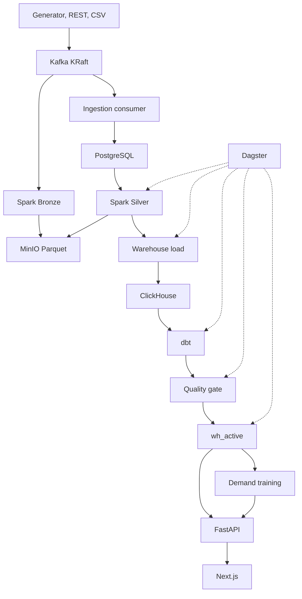
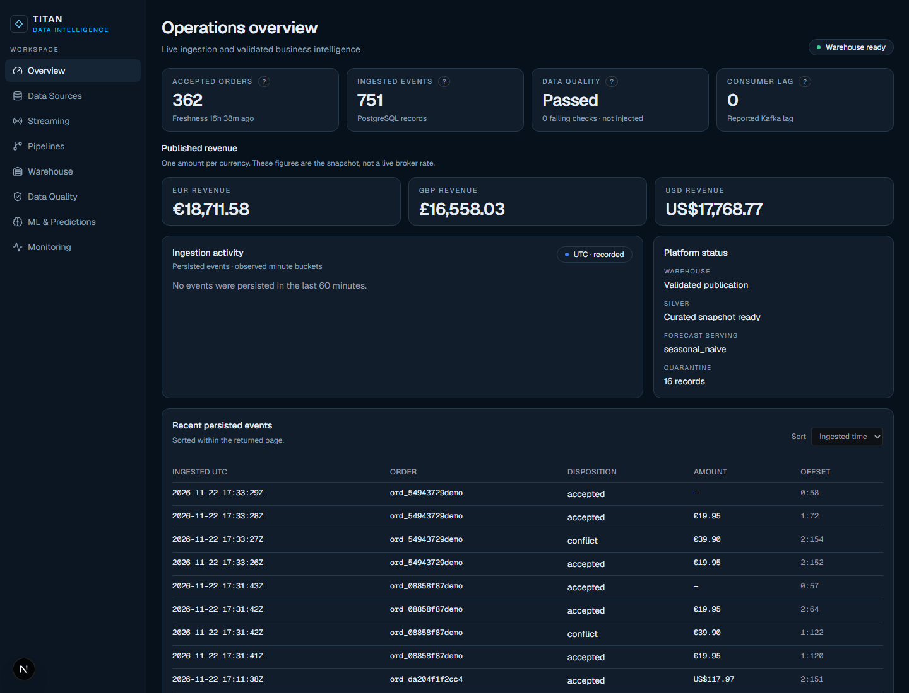
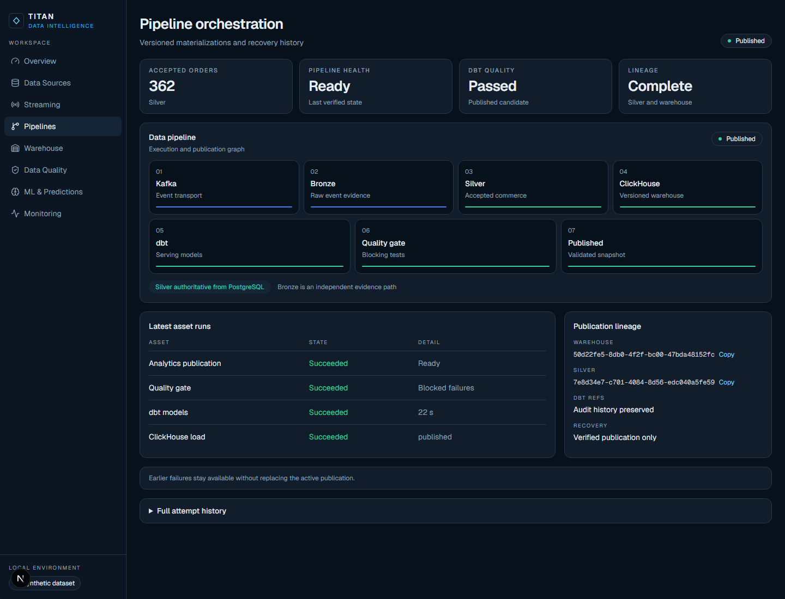
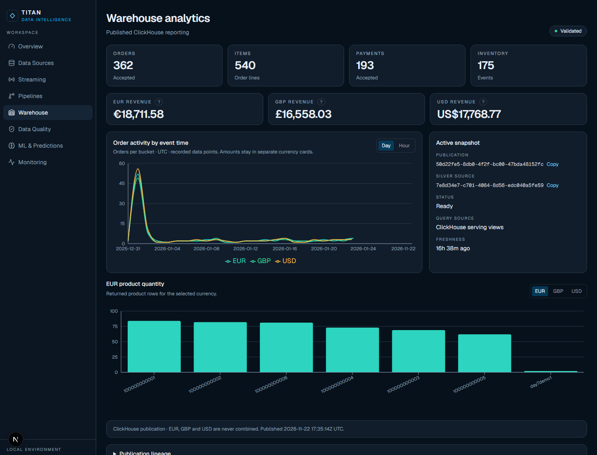
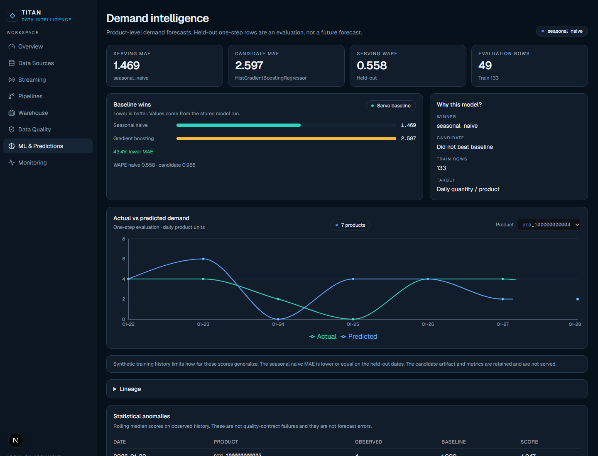
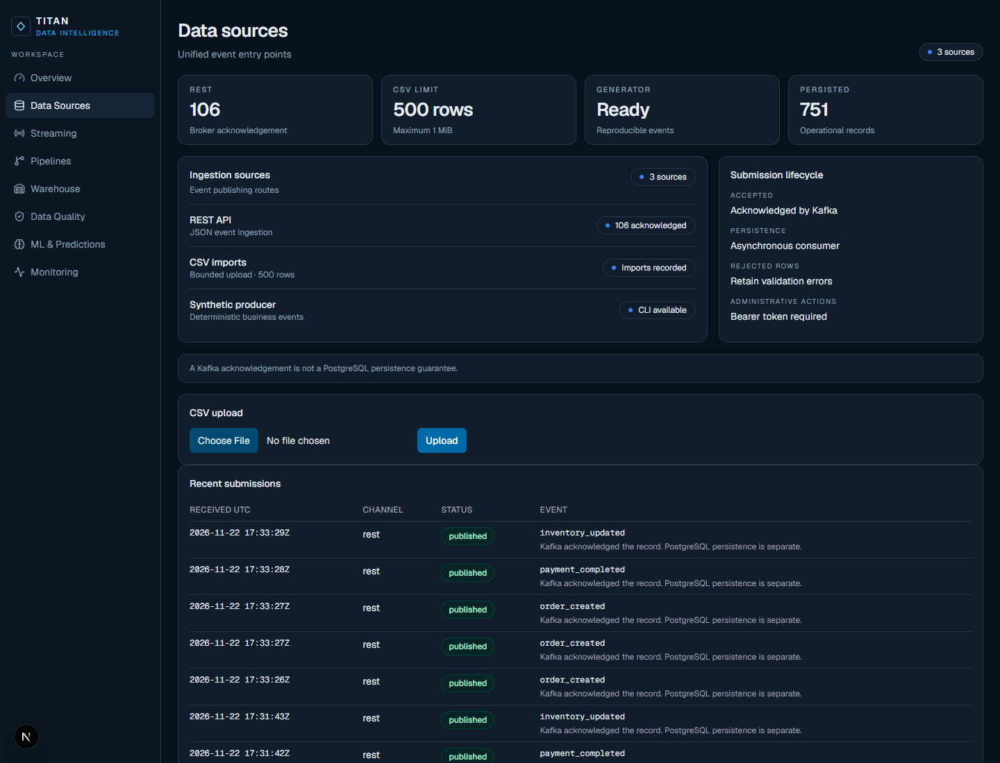
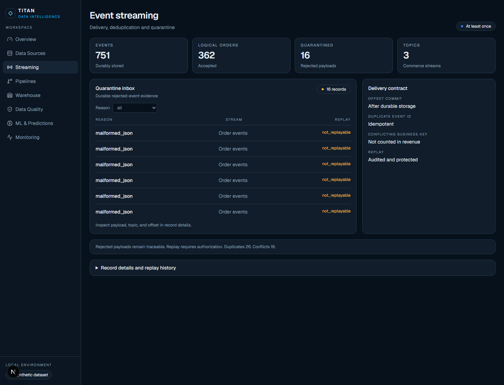
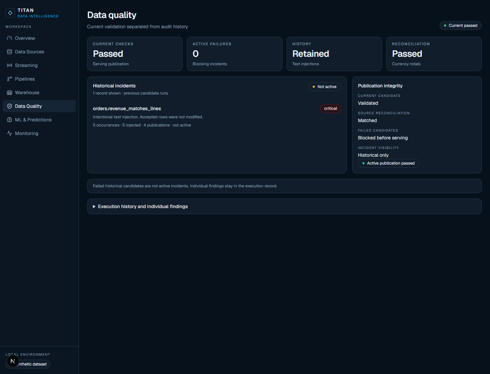
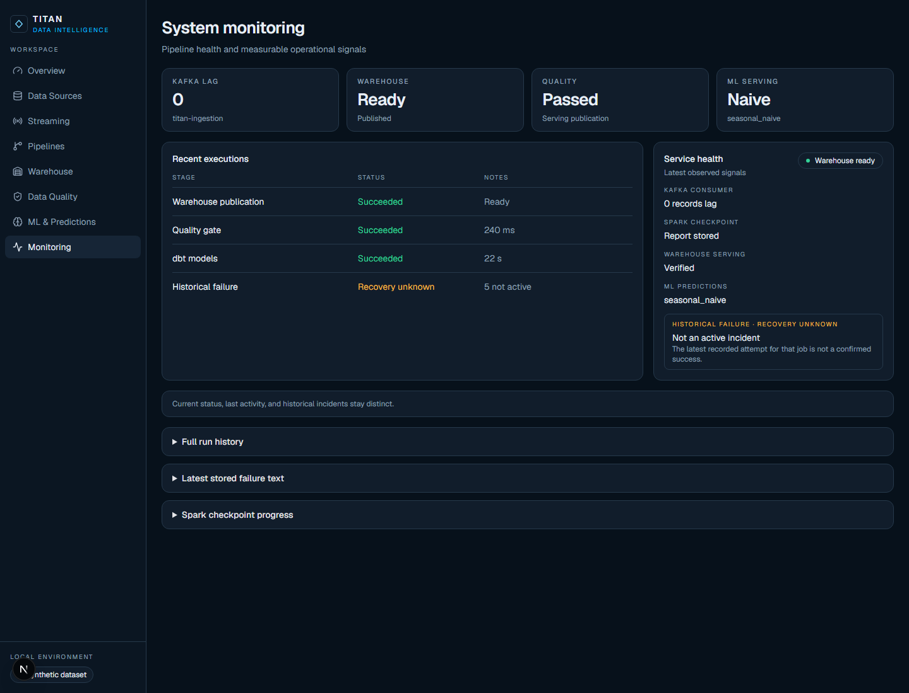

# TITAN

[](https://github.com/Ibrahem-Ali-99/TITAN/actions/workflows/ci.yml)

TITAN answers one commerce question: which orders were accepted, in which currency, and which published snapshot is safe to show. Events arrive from a synthetic generator, REST, or CSV. A consumer classifies each one. Analytics are served only from the warehouse publication that PostgreSQL and ClickHouse both still name, after dbt and a blocking quality gate.

The data is synthetic. Delivery is at-least-once with idempotent persistence. It is not end-to-end exactly-once. The running shape is one workstation Compose project. That is a portfolio system, not a production deployment. The distinction is [below](#local-scale-and-production-readiness).

## Stack

Versions are the pins in Compose, `pyproject.toml`, and `apps/web/package.json`.

| Layer | Choice |
| --- | --- |
| Language and images | Python 3.12, uv 0.12.1, Node.js 26.13.1 for the web job and image |
| Contract and client | Pydantic 2.14.4, confluent-kafka 2.16.2 |
| Transport | Apache Kafka 4.4.0, KRaft, one broker |
| Operational store | PostgreSQL 18.7, SQLAlchemy 2.1.9, Alembic 1.20.1, psycopg 3.3.9 |
| Lake | Spark 4.0.1 on Java 21, Parquet on MinIO `alpine/minio:RELEASE.2025-10-15T17-29-55Z` |
| Warehouse | ClickHouse 26.8.36.3, dbt-core 1.12.7, dbt-clickhouse 1.10.3 |
| Orchestration | Dagster 1.13.31. The daemon is off unless the `orchestration` profile is started |
| Quality and forecasts | Project quality checks, scikit-learn 1.7.2 |
| Serving | FastAPI 0.165.0, Uvicorn 0.54.0, Next.js 16.4.6, React 19.3.0 |
| Checks | Ruff 0.17.6, mypy 2.4.1, pytest 9.2.0, and [`.github/workflows/ci.yml`](.github/workflows/ci.yml) |

Redis, Kubernetes, and a schema registry are not part of this repository.

## Architecture



Solid arrows are data. Dotted arrows are job order. Dagster does not transform rows. Spark writes Bronze from Kafka and Silver from PostgreSQL dispositions. Spark does not write `commerce_events`. Quality checks and demand training read a warehouse publication and write their own metadata.

The guarantee table is in [docs/portfolio/architecture.md](docs/portfolio/architecture.md). Ownership and the Day 1 slice are in [docs/architecture.md](docs/architecture.md).

| Path | Responsibility |
| --- | --- |
| `packages/contracts` | Event envelope and money rules |
| `packages/store` | Operational tables and Alembic migrations |
| `services/ingestion` | Consume, classify, then commit the offset |
| `pipelines/spark` | Bronze evidence and a Silver version |
| `pipelines/warehouse` | ClickHouse load, pointer exchange, reconcile |
| `warehouse/dbt` | Models and tests on one publication |
| `pipelines/dagster` | Asset order and the stopped hourly schedule |
| `pipelines/quality` | Blocking publication checks |
| `pipelines/ml` | Demand training and the serving choice |
| `apps/api`, `apps/web` | Read models and the eight-page console |

## How the path works

**Ingestion.** The generator, REST, and CSV all publish the same envelope to Kafka. The consumer is the only writer of `commerce_events`. Automatic offset commits are off. A row is stored, or a bad record is quarantined, and only then is the offset committed. The same `event_id` does not become a second row. A new `event_id` with a different payload for an order or payment already stored is a `conflict`, kept as evidence and excluded from accepted revenue. Details: [docs/consumption-semantics.md](docs/consumption-semantics.md) and [docs/ingestion-hub.md](docs/ingestion-hub.md).

**Processing.** Spark Bronze copies Kafka records, including invalid values, into MinIO. A batch is readable after `bronze_batch_commits`. Silver builds one version from the PostgreSQL classification. The Spark checkpoint is a local volume, not an object-store rename. Details: [docs/spark-lake.md](docs/spark-lake.md).

**Storage.** PostgreSQL holds the operational classification, quarantine, pipeline history, quality findings, and model-run rows. MinIO holds Bronze and Silver Parquet. ClickHouse holds every staged publication. Serving models read the one id in `wh_active`. Money is decimal and keeps its currency code. Policy: [docs/money-policy.md](docs/money-policy.md).

**Analytics.** dbt builds the models readers query. The quality gate runs before the pointer moves. A blocking failure marks that load failed and leaves the previous publication in place. `TITAN_QUALITY_INJECT=revenue_mismatch` is an injected test fault. It does not change accepted orders. Dagster orders Silver, the load, dbt, the gate, and `analytics_ready`. The hourly schedule exists and does not run while the daemon is stopped. Details: [docs/warehouse.md](docs/warehouse.md).

**Forecasts.** Training uses daily quantity per product from the active publication. The last seven dates are the test week. One-step rows use earlier actuals. The forward week is recursive and does not read a future actual. `hist_gradient_boosting` is served only when its held-out MAE is strictly lower. Otherwise the label is `seasonal_naive`, and the candidate artifact stays in `ml_runs`. On the development publication below, the baseline won. A separate clean-clone dataset served the candidate because its MAE was lower there. Those are two results, not one model claim. Details: [docs/quality-ml.md](docs/quality-ml.md).

**Monitoring.** The API reports ingestion lag for consumer group `titan-ingestion`, Spark progress, and the latest `pipeline_runs` row per job. Lag is not the Spark checkpoint. A success of another job does not rewrite an older failure. Historical `warehouse_load` rows that were stored as `running` with a finish time stay labeled recovery unknown. They were not rewritten. Details: [docs/reliability.md](docs/reliability.md) and [docs/quality-ml.md](docs/quality-ml.md).

## Operations console

Captured 2026-11-23 from `http://localhost:3000` at 1440×1100. The development volumes were already published. Warehouse `50d22fe5-8db0-4f2f-bc00-47bda48152fc` was still the serving snapshot: 362 accepted orders, EUR 18711.58, GBP 16558.03, USD 17768.77. The forecast title was `seasonal_naive`. Freshness of about 16 hours is the age of the 2026-11-22T17:35:14Z publication. The capture notes are [docs/portfolio/screenshots.md](docs/portfolio/screenshots.md).









<details>
<summary>Data Sources, Streaming, Data Quality, and Monitoring</summary>









</details>

## Engineering choices

**Kafka idempotency.** Producer idempotence covers broker retries. It does not share a transaction with PostgreSQL. The consumer commits an offset after the database insert or the quarantine insert. A crash between those two steps redelivers the record. The `event_id` primary key and the duplicate-delivery observation keep that from becoming another accepted order. A conflicting business payload is stored and is not counted as a second order.

**Spark checkpoint recovery.** The checkpoint volume is local because an S3A directory rename is not a safe commit. On 2026-11-22 an isolated project SIGKILLed the Bronze driver after the Parquet copy and before `bronze_batch_commits`. The commit directory was empty. Restart on the same checkpoint wrote one commit for those 9 records. PostgreSQL and ClickHouse then agreed on 5 accepted orders, 10 line items, and the same three currency sums. The development database stayed at 362 accepted orders. Write-up: [docs/audits/spark-crash-recovery.md](docs/audits/spark-crash-recovery.md).

**Publication consistency.** `wh_active` and the PostgreSQL load row are not one transaction. The API reports `ready: false`, and withholds analytics, when those ids disagree or when the active id is missing a passing quality run, a successful dbt run, a published Silver lineage, or matching fact counts. An injected revenue mismatch during the recorded demo left the previous publication serving until a clean run. The clean run published `50d22fe5-8db0-4f2f-bc00-47bda48152fc`.

**Reconciliation.** `python -m titan_warehouse --reconcile` points `wh_active` at the newest verified publication. It does not copy the facts again. If nothing is verified, it leaves the pointer. On the isolated end-to-end project, a crash after the ClickHouse exchange left the API not ready. After the recovery fix, reconcile restored publication `0e171bf1-0d3f-4c2f-bb7c-9f23f4d9287b` with 11 orders and the same currency sums. Currencies are never added. Unfiltered ClickHouse tables still contain staged and failed loads. Serving views filter on the active id. Write-up: [docs/audits/end-to-end-reliability.md](docs/audits/end-to-end-reliability.md).

## Evidence

These figures were executed and written down. They were not re-run for this README. Each row names the run that produced it.

### Hosted CI

[`.github/workflows/ci.yml`](.github/workflows/ci.yml) runs on push and pull request. The `python` job uses frozen uv 0.12.1 and Python 3.12 for Ruff, mypy, `pytest -m "not integration"`, the secret scan, and `pip-audit` 2.10.1. The `orchestration` job validates Dagster definitions. The `web` job uses Node.js 26.13.1 for `npm ci`, `npm audit`, tests, lint, typecheck, and `next build`. Permissions are `contents: read`.

On `master`, the hosted runs for [`e1ba23e`](https://github.com/Ibrahem-Ali-99/TITAN/actions/runs/45079314376), [`bbd6a2d`](https://github.com/Ibrahem-Ali-99/TITAN/actions/runs/45080449906), and [`49f9737`](https://github.com/Ibrahem-Ali-99/TITAN/actions/runs/45082135654) completed successfully on 2026-11-22. The first push, [`5b30029`](https://github.com/Ibrahem-Ali-99/TITAN/actions/runs/45078387497), failed and the later commits fixed that workflow. The badge follows the default branch. A commit that is not yet pushed has no hosted run.

### Workstation suites

Recorded in [docs/audits/release-candidate-verification.md](docs/audits/release-candidate-verification.md) and [docs/audits/end-to-end-reliability.md](docs/audits/end-to-end-reliability.md).

| Check | Result | Where |
| --- | --- | --- |
| Ruff, format, mypy, secret scan | Passed. mypy reported 84 files. Format reported 138 files | Workstation, after the secret-scan fix |
| `pytest -m "not integration"` | 61 passed, 1 deselected | Same workstation run |
| `pytest -m integration` | 1 passed, 55 deselected | Isolated project `titan-e2e` |
| Spark image tests | 11 passed in 31.70 s | `titan-e2e` |
| dbt with `TITAN_DBT_GATE=fail` | `PASS=21 ERROR=1`. The pointer did not move | `titan-e2e` |
| `dagster definitions validate` | Validation successful | Candidate checkout `6ebd47d` |
| Web `npm test`, lint, typecheck, audit, build | 10 tests passed, 0 npm audit findings, Next.js 16.4.6, 11 routes | Candidate `6ebd47d`, web container |
| axe-core 4.10.3 | No violations on eight routes at 1440×900, 1024×768, 768×1024, and 390×844 | `http://localhost:3000` after the console restart |
| `pip-audit` 2.10.1 | No known vulnerabilities in the frozen third-party export | Same release-candidate pass |

`pytest -m integration` was not repeated after that isolated run. The audits still call the overall release **conditional** because a two-member Kafka rebalance and a MinIO outage during a write were not executed.

### Measurements

Producer acknowledgements from [`benchmarks/day7-5000.json`](benchmarks/day7-5000.json), measured `2026-11-22T17:31:28.666544+00:00` on an AMD Ryzen 7 9800X3D with 32 GB of RAM. Docker Desktop showed about 13.65 GiB for containers without an explicit limit. Other local containers were running. Kafka was 337 MiB of 768 MiB before the sample and 375 MiB after.

| Scope | Result |
| --- | --- |
| Topic | `titan.benchmark.acks` |
| Records | 5000, seed 71022 |
| Elapsed | 4.22 s |
| Acknowledged / second | 1184.964 |
| Ack p50 / p95 / p99 | 0.000598 s / 0.000843 s / 0.001013 s |
| `logical_orders` | 360 before and after |
| Ingestion lag | 0 before and after |

Ingestion does not consume that topic. This is producer acknowledgement time. It is not warehouse freshness, not HTTP latency, and not a capacity figure. An earlier 100-event sample in [`benchmarks/day6-100.json`](benchmarks/day6-100.json) did enter PostgreSQL. Do not describe either sample as sustained end-to-end throughput.

API wall clock from the [final engineering audit](docs/audits/final-engineering-audit.md), 10 sequential `Invoke-RestMethod` calls on the same development stack:

| Endpoint | min | p50 | max |
| --- | --- | --- | --- |
| `GET /api/v1/warehouse/status` | 30 ms | 32 ms | 85 ms |
| `GET /health/ready` | 46 ms | 48 ms | 52 ms |

The same audit reconciled the serving snapshot: PostgreSQL and ClickHouse both had 362 orders, 540 items, 193 payments, and the three currency sums above. `wh_orders` without the publication filter was 6517 because earlier staged loads remain in the table.

The recorded demo, [`benchmarks/demo-day7.json`](benchmarks/demo-day7.json), added `ord_54943729demo` at EUR 19.95 and moved the serving publication from `a44926d4-0d7d-4a30-857d-d543341475a0` to `50d22fe5-8db0-4f2f-bc00-47bda48152fc`. The serving forecast stayed `seasonal_naive` on run `3a3f7264-818c-4e85-9b56-4793d68157ef`, trained on the earlier 259-order publication. Candidate MAE was 2.5971 and seasonal-naive MAE was 1.469388 on 49 test rows. The console rounds those MAE values to three decimals.

A clean clone on project `titan-clone` published a different snapshot, `9cb0b695-4327-4ad5-b3db-f8a008177862`, with 187 orders, and served `hist_gradient_boosting` because that candidate beat the baseline on that history. Development orders stayed 362. Write-up: [docs/audits/clean-clone-release.md](docs/audits/clean-clone-release.md).

## Run it

### Prerequisites

Windows PowerShell, Docker Desktop with at least 8 GB of memory, Python 3.12, and [uv](https://docs.astral.sh/uv/) 0.12.x. The images pin uv 0.12.1. Host Node.js is required only for `npm test`, `npm run lint`, and `npm run build` outside Docker. The web image and the web CI job use Node.js 26.13.1.

Compose memory limits: Kafka 768 MiB, PostgreSQL 512 MiB, MinIO 256 MiB, ClickHouse 1536 MiB, Spark 1536 MiB, ingestion 512 MiB, API 512 MiB, web 768 MiB, Dagster daemon 768 MiB.

No hidden environment variables. Host tools read `.env` from the repository root. Compose reads that file for interpolation. `COMPOSE_PROJECT_NAME` and `COMPOSE_FILE` must be set in the shell for the isolated overlay, because Compose does not take its file list from `.env`.

The Compose file sets `name: titan`. A second checkout that runs `docker compose up` without another project name attaches the development volumes `titan_*`.

### Quick start

These commands start the development project. Skip them when that project is already running and use the isolated checkout below.

```powershell
copy .env.example .env
docker compose up --build -d
docker compose run --rm --build migrate
uv sync --all-packages
uv sync --group orchestration
uv run python scripts/verify_infrastructure.py
```

The API is http://localhost:8000 and the console is http://localhost:3000. Profiles: `generate` for the containerized producer, `processing` for Spark, `orchestration` for the optional Dagster daemon. The daemon is off by default so the hourly warehouse job does not publish on its own. The first `processing` command builds `titan-spark:4.0.1`.

```powershell
docker compose down
```

That stops the `titan` containers and keeps the named volumes. Do not add `-v` unless you intend to delete the development PostgreSQL, Kafka, MinIO, ClickHouse, Spark checkpoint, and Dagster data.

Set `TITAN_ADMIN_TOKEN` in `.env` and recreate the API before replay or CSV resume. `.env.example` already contains the local placeholder `local-demo-token`. An empty token makes those two calls return 401. REST publication and CSV upload stay open on localhost. This is a workstation boundary, not a public deployment.

Pinned images and the money rules are in [docs/local-infrastructure.md](docs/local-infrastructure.md) and [docs/money-policy.md](docs/money-policy.md).

### Isolated checkout

Use this when the development stack is already up, or when the demonstration must start from empty volumes. The checkout directory must not contain a copied `.env`, `.venv`, database dump, or `node_modules`.

```powershell
$env:COMPOSE_PROJECT_NAME = "titan-clone"
$env:COMPOSE_FILE = "docker-compose.yml;docker-compose.clone.yml"
copy .env.clone.example .env
docker compose up --build -d
docker compose run --rm --build migrate
uv sync --all-packages
uv sync --group orchestration
uv run python scripts/verify_infrastructure.py
```

`verify_infrastructure.py` checks Postgres, Kafka, ClickHouse, and MinIO on the ports in `.env`. For any project name other than `titan`, it also requires the Postgres container to mount `<project>_postgres_data` and refuses `titan_postgres_data`.

| Service | Clone host port |
| --- | --- |
| Kafka | localhost:29092 |
| PostgreSQL | localhost:25435 |
| ClickHouse | localhost:28123 |
| MinIO | localhost:29000 |
| API | http://localhost:28000 |
| Console | http://localhost:23000 |

Stop the clone without touching development volumes:

```powershell
$env:COMPOSE_PROJECT_NAME = "titan-clone"
$env:COMPOSE_FILE = "docker-compose.yml;docker-compose.clone.yml"
docker compose down
```

`docker compose -p titan-clone down -v` deletes only `titan-clone_*` volumes. Do not run `down -v` while `COMPOSE_PROJECT_NAME` is unset or `titan`.

### First publication

`scripts/demo_day7.py` adds one order to a warehouse that is already `ready` and leaves the serving forecast in place. A new database has neither. From the same shell as the quick start or the isolated checkout:

```powershell
uv run python -m event_generator --history-days 28 --seed 51022 --rate 0
docker compose --profile processing run --rm spark-bronze
docker compose --profile processing run --rm spark-silver
uv run --group orchestration python scripts/run_pipeline.py titan_warehouse
uv run --group orchestration python scripts/run_pipeline.py titan_ml
```

The generator publishes a deterministic 28-day backfill through Kafka. Spark Bronze and Silver run once. `titan_warehouse` loads ClickHouse, runs dbt, and promotes the publication only after the quality gate. `titan_ml` trains on that publication and serves `seasonal_naive` unless the candidate MAE is strictly lower. `scripts/run_pipeline.py` adds the pipeline source trees and loads `.env` before the module starts, so a new shell does not need a hand-built `PYTHONPATH`.

Wait until `GET /api/v1/warehouse/status` reports `"ready": true` before the demo.

### Demo

```powershell
uv run python scripts/demo_day7.py
```

The walkthrough is [DEMO.md](DEMO.md). A narration for the eight pages is [docs/portfolio/demo-script.md](docs/portfolio/demo-script.md). The last successful development run is the publication in the screenshots above. A second run uses a new identifier. It does not reset volumes.

### Local checks

```powershell
uv run ruff check
uv run ruff format --check
uv run mypy
uv run pytest -m "not integration"
uv run python scripts/scan_secrets.py
docker compose --profile processing run --rm --no-deps spark-tests
uv run --group orchestration dbt build --no-partial-parse --project-dir warehouse/dbt --profiles-dir warehouse/dbt
$env:DAGSTER_HOME = (Resolve-Path pipelines/dagster/home)
$env:PYTHONPATH = "pipelines/warehouse/src;pipelines/quality/src;pipelines/ml/src;pipelines/dagster/src"
uv run --group orchestration dagster definitions validate -w pipelines/dagster/workspace.yaml
```

Live scripts, each of which needs the stack:

```powershell
uv run python scripts/verify_day7.py
uv run python scripts/demo_day7.py
$env:TITAN_WEB_BASE_URL = "http://localhost:3000"
uv run --with playwright python scripts/audit_a11y.py
```

`audit_a11y.py` opens the eight console routes at 1440×900, 1024×768, 768×1024, and 390×844 after the page has finished loading. Point `TITAN_WEB_BASE_URL` at the console you started. The clone console is `http://localhost:23000`. The first run needs Playwright Chromium (`uvx --from playwright playwright install chromium`).

`verify_day7.py` stops Kafka, checks that the warehouse status stays ready, starts Kafka, and runs reconcile. Day 2 through Day 6 scripts remain in `scripts/` for the earlier milestones.

The 5,000-event acknowledgement sample:

```powershell
$env:TITAN_BENCH_COUNT = "5000"
$env:TITAN_BENCH_SEED = "71022"
uv run python scripts/benchmark_ingestion.py
```

## Local scale and production readiness

TITAN is built to be inspected on one machine. The checks above show that this path can classify events, recover a killed Spark batch, refuse a bad publication, and serve one agreed snapshot. They do not show a production deployment.

| Present in this repository | Not established |
| --- | --- |
| One Kafka broker, replication factor 1, workstation ports | A multi-broker cluster, or a live two-member rebalance |
| Local placeholder passwords in Compose and `.env.example` | Credential rotation, network policy, or public authentication |
| Admin replay and CSV resume fail closed when the token is empty. REST and CSV upload stay open on localhost | An ingestion surface that is safe on the public internet |
| Next.js development server in Compose. `next build` runs in CI | A deployed console |
| Dagster daemon off by default. The profile mounts the Docker socket so scheduled jobs can launch Spark | An unattended production scheduler |
| MinIO community image running as `user: "0:0"` so a named volume can initialize | A production object store or a hardened image |
| One 5,000-record producer-ack sample and a 10-call API latency sample | Capacity, cost, or a soak test |
| Synthetic customers, products, and demand | A real catalog or a measured business result |
| Hosted CI green for the commits named above | A release sign-off. The audits remain conditional on the gates they mark unverified |

A green GitHub Actions run checks this repository. It does not promote the workstation stack to production.

## Decisions and limits

- Offset commit follows a durable PostgreSQL write. There is no distributed transaction across Kafka, PostgreSQL, MinIO, and ClickHouse.
- Bronze is invisible to readers until its commit row exists. A partial prefix is not a completed batch.
- An older Silver snapshot cannot replace a warehouse built from a later one.
- The gradient-boosting hyperparameters are fixed. They are not searched against the test week.
- Historical `pipeline_runs` rows that recorded `running` with a finish time were left in place. Monitoring does not call them recovered.
- The web container runs `next dev`. Node's module-type warning and the Starlette `TestClient` warning were left as recorded in the audits.
- GitHub Actions use major version tags for the checkout, uv, and Node setup actions, not commit SHAs.
- No claim is made for a real merchant, a cost saving, or exactly-once delivery.

Longer notes: [docs/audits/final-engineering-audit.md](docs/audits/final-engineering-audit.md), [docs/portfolio/case-study.md](docs/portfolio/case-study.md), [docs/portfolio/resume.md](docs/portfolio/resume.md).

## Troubleshooting

- `docker compose up` in a second directory changes the development containers. The file sets `name: titan`. Export `COMPOSE_PROJECT_NAME` and `COMPOSE_FILE` before every Compose command in that shell.
- `verify_infrastructure.py` reports `FAIL postgres container ... is not inspectable` when the project name in `.env` does not match the containers that are running.
- A variable already set in the shell hides the same name in `.env`. The loaders use `setdefault`. Clear `DATABASE_URL`, `CLICKHOUSE_PORT`, and `S3_ENDPOINT` in that shell before the clone checks, or the commands talk to another project's ports.
- Postgres `localhost` can spend the whole connect timeout on IPv6. `.env.clone.example` uses `127.0.0.1` for `DATABASE_URL`. Kafka, ClickHouse, and MinIO stay on `localhost` with their clone ports.
- `/api/v1/warehouse/status` stays `ready: false` until Silver, dbt, and the quality gate have promoted a publication. `scripts/demo_day7.py` exits in that state. Run the first-publication commands.
- Replay or CSV resume returns 401 when `TITAN_ADMIN_TOKEN` is empty. Set the placeholder, then `docker compose up -d --force-recreate api`.
- dbt or the warehouse command cannot reach ClickHouse when `CLICKHOUSE_PORT` is still `8123` while the clone publishes `28123`. Use `.env.clone.example` with the clone overlay.
- The first Spark command spends several minutes building `titan-spark:4.0.1`. Later runs reuse the image.

## Documentation

| Document | What it covers |
| --- | --- |
| [DEMO.md](DEMO.md) | What `scripts/demo_day7.py` changes |
| [docs/architecture.md](docs/architecture.md) | Ownership and the operational path |
| [docs/portfolio/architecture.md](docs/portfolio/architecture.md) | Store guarantees |
| [docs/consumption-semantics.md](docs/consumption-semantics.md) | Offset commit and redelivery |
| [docs/ingestion-hub.md](docs/ingestion-hub.md) | REST, CSV, quarantine, replay |
| [docs/spark-lake.md](docs/spark-lake.md) | Bronze, Silver, and checkpoints |
| [docs/warehouse.md](docs/warehouse.md) | ClickHouse publication |
| [docs/quality-ml.md](docs/quality-ml.md) | Quality gate, monitoring, forecasts |
| [docs/reliability.md](docs/reliability.md) | Recovery and the local admin token |
| [docs/money-policy.md](docs/money-policy.md) | Currency and decimal rules |
| [docs/local-infrastructure.md](docs/local-infrastructure.md) | Ports, images, and volume reset |
| [docs/portfolio/screenshots.md](docs/portfolio/screenshots.md) | Capture conditions for the eight frames |
| [docs/audits](docs/audits) | Executed audits and their verdicts |
