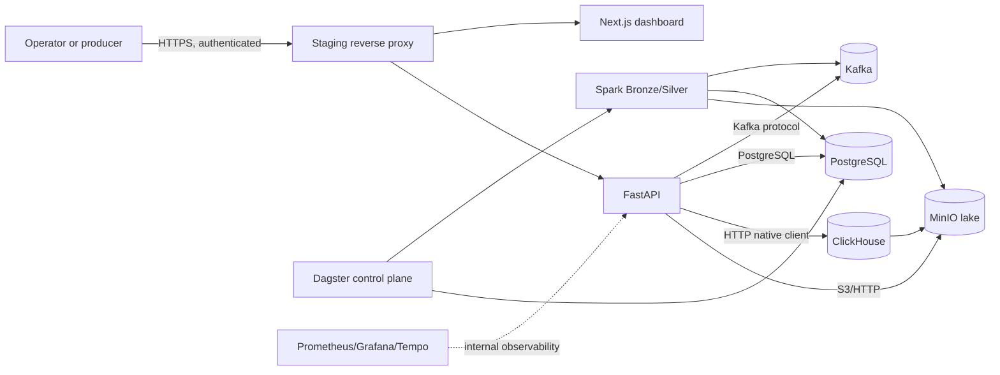

# TITAN Secure Deployment Architecture — Upgrade 6A

**Status:** architecture proposal; no deployment changes made  
**Reference revision:** `426f83b74bf4c01f7a9d226c5b119d33818f41f3`  
**Immediate target:** single-host shared staging  
**Production posture:** future design, not an approval

## 1. Current architecture and boundaries

The repository's Compose graph contains Kafka, PostgreSQL, ClickHouse, MinIO,
FastAPI, Next.js, Spark Bronze/Silver, Dagster, Prometheus, Grafana, Tempo,
OpenTelemetry, exporters, migration, and fixture services. Internal clients use
Compose DNS: Kafka `kafka:19092`, PostgreSQL `postgres:5432`, ClickHouse
`clickhouse:8123`, and MinIO `minio:9000`. Host tools use loopback-published
ports. The base stack is intentionally local-development oriented and retains
development credential fallbacks.

The local Dagster override can mount `/var/run/docker.sock` to launch Compose
Spark jobs. The default/protected Dagster service does not mount it. This is a
deliberate local trust boundary, not a safe multi-user executor.

## 2. Deployment trust boundaries

### A. Trusted workstation

Keep the current local Compose behavior: loopback host bindings, local-only
dashboard proxy, development credentials from an ignored `.env`, and explicit
operator trust. The host user and Docker daemon are trusted. Do not expose the
ports through a LAN address or share raw backups. The local Dagster socket
override is supported only for trusted code and schedules.

### B. Shared staging reference architecture

Use one controlled host and a dedicated Compose project with new named volumes,
an internal-only Docker network, and a reverse proxy bound to the staging
interface. Only HTTPS for the dashboard/API and an operator-only observability
endpoint are published. Kafka, PostgreSQL, ClickHouse, MinIO, Spark, Dagster,
exporters, and tracing remain un-published.

The proxy authenticates users with an organization identity provider or an
OIDC-capable access gateway and forwards an asserted identity to FastAPI. FastAPI
still enforces its own scopes; the proxy is not a bypass. Staging uses separate
service credentials, TLS certificates, and backup prefixes from development.
No Docker socket is mounted. Spark is launched by a trusted host-side launcher
or a bounded worker process with an allowlisted job interface.

### C. Network-accessible production

Production must not be treated as merely staging with public ports. It requires
multi-host failure planning, replicated Kafka/PostgreSQL/ClickHouse/MinIO or
managed equivalents, external load balancing, independent key custody,
centralized audit logs, tested backup retention, and a coordinated recovery
contract. The single-host Compose design can be a controlled reference, not an
HA guarantee.

## 3. Service communication matrix

| Source | Destination | Protocol/port | Identity/authentication | Encryption target |
|---|---|---|---|---|
| Staging proxy | Next.js/API | HTTPS 443 / internal HTTP | OIDC user session; API scopes remain enforced | TLS at proxy; internal mTLS or private network |
| Next.js server proxy | FastAPI | HTTP 8000 initially | Dedicated read/write service tokens from secret file; no browser token | Private network; mTLS before production |
| FastAPI/ingestion | Kafka | 19092 internal | Dedicated producer/consumer identities | Kafka SASL/TLS |
| FastAPI/migrations | PostgreSQL | 5432 | Separate least-privilege DB roles | PostgreSQL TLS |
| FastAPI/warehouse | ClickHouse | 8123/9000 internal | Read/write roles, no default user | ClickHouse TLS |
| FastAPI/Spark/warehouse | MinIO | 9000 | Scoped S3 users and bucket policies | HTTPS/S3 TLS |
| Spark Bronze/Silver | Kafka/PostgreSQL/MinIO | Internal service ports | Job-specific identities | SASL/TLS, DB TLS, S3 TLS |
| Dagster host launcher | Spark worker | Local authenticated launcher API | Allowlisted job identity | Unix socket or loopback mTLS |
| Prometheus | exporters/API | Internal scrape ports | Network policy and scrape credentials where supported | Private network; TLS for remote scrape |
| Grafana | Prometheus/Tempo | Internal APIs | Named user/OIDC; read-only data sources | Private network/TLS |
| Backup operator | DR destinations | Service-specific | Recovery role, separate from runtime writer | TLS plus encrypted archives |

Exact TLS support and client options must be proven in disposable staging before
cutover; the current local plaintext listeners are not reused for shared access.

## 4. Secret ownership and lifecycle

| Secret | Owner | Consumer | Storage/rotation |
|---|---|---|---|
| API read/write/admin credentials | Platform security | FastAPI, server-side dashboard, operators | OIDC/service secret store; rotate independently; revoke on incident |
| PostgreSQL runtime/migration roles | Data platform | API, ingestion, migration, DR | Separate roles; rotation maintenance window and rollback |
| Kafka producer/consumer credentials | Streaming owner | API, ingestion, Spark | Per-service SASL identities; revoke by client ID |
| ClickHouse users | Warehouse owner | API/dbt/recovery | Separate read, load, and admin roles; TLS and rotation |
| MinIO S3 users | Lake owner | Spark/warehouse/DR | Bucket/prefix policies; no root key in workloads |
| TLS private keys | Platform security | Proxy and services | External key store or protected host ACL; renewal before expiry |
| Backup encryption keys | DR owner | Backup/restore jobs | External KMS/HSM or approved equivalent; escrow and rotation |
| CI credentials | CI owner | Disposable workflows | Ephemeral repository/environment secrets; never development credentials |

`TITAN_SECURITY_PROFILE=protected` is an application guard, not a complete
secret store. Staging must provision all service credentials from protected
files or an external injector and reject placeholders before Compose startup.

## 5. Technology decisions

### TLS termination and identity

Use an OIDC-capable reverse proxy/access gateway in front of Next.js and
FastAPI, with ACME or an enterprise CA for certificates. This avoids adding an
identity provider to TITAN itself while providing browser sessions, MFA and
revocation. Alternatives are a corporate ingress proxy or a dedicated OIDC
sidecar. Preserve FastAPI bearer scope checks until end-to-end identity mapping
is tested. Roll back by removing the staging proxy route while keeping services
bound to the private network.

### Internal service encryption

Adopt Kafka SASL/SCRAM over TLS first because Kafka is the primary event trust
boundary. Enable PostgreSQL, ClickHouse, and MinIO TLS with client-library
verification next. mTLS is justified for service-to-service production traffic;
staging may use server TLS plus private networking if client certificate support
is verified. Each change needs a dual-configuration migration window and a
disposable Compose test with certificate expiry and invalid-credential cases.

### Secrets

Use mounted secret files or an approved host-side secret injector for staging;
do not build a Vault/Kubernetes dependency into this Compose reference. The
application and scripts must accept file-based credentials without printing
them. Rotation is staged: create new identity, test, switch consumers, revoke
old identity, and retain a time-bounded rollback secret.

### Socket-free Dagster/Spark

Preferred design: Dagster submits a bounded request to a trusted host-side Spark
launcher. The launcher owns Docker lifecycle, allowlists image digest, command,
resources, volumes, and network, and returns an execution ID. Dagster never
receives the Docker socket. A restricted Docker API proxy is a fallback only if
its endpoint allowlist is independently tested; read-only socket mounts are not
a security boundary.

### Encrypted backups

Use a mature authenticated-encryption tool/library integrated with externally
managed keys. Encrypt PostgreSQL logical archives, Kafka exports, MinIO objects,
and recovery manifests before leaving the host. Preserve existing SHA-256
manifests for integrity and verify ciphertext authentication before restore.
Key loss must fail closed; restore tests must cover wrong key, tampering,
rotation, and retention deletion. Plain POSIX permissions remain an additional
control, not encryption.

## 6. Required code and Docker changes

1. Add a protected Compose overlay with no development fallbacks, no public data
   service ports, secret-file inputs, explicit `TITAN_SECURITY_PROFILE`, and
   TLS/SASL configuration.
2. Add file-based secret loading and startup validation for every service that
   currently receives environment fallbacks; redact connection strings in
   diagnostics.
3. Add an OIDC-aware proxy/session boundary while preserving FastAPI scope
   enforcement and dashboard path/method allowlists.
4. Replace the Dagster local socket path for staging with the host launcher.
5. Split PostgreSQL/ClickHouse/MinIO runtime, migration, load, and recovery
   identities; remove root MinIO operation after a tested volume migration.
6. Add backup encryption, key references (never keys in manifests), retention,
   and artifact redaction.
7. Add network/TLS readiness probes and security regression fixtures.

## 7. Certificate and key management

Certificates need names, SANs, owner, issuer, expiry, renewal threshold,
deployment target, and revocation procedure. Private keys live outside Git and
outside ordinary Compose environment interpolation. Rotate service credentials
independently from TLS certificates. Recovery operators need read access to the
backup key version and destination credentials, but not routine write access to
live services.

## 8. Backup and recovery design

The coordinated recovery boundary remains quiesced and non-atomic. Staging
backups must capture PostgreSQL, Kafka, MinIO/Silver, and warehouse lineage with
one operator-approved boundary, encrypt each artifact, and verify all manifests
before restore. Do not restore Spark checkpoints blindly. Keep serving inactive
until event dispositions, Silver checksums, warehouse reconciliation, lineage,
quality gates, and publication atomicity pass. Production adds replicated
storage, retention/immutability, key escrow, and regular restore drills.

## 9. Threat model and residual risks

Threats include a remote client, compromised staging container, malicious
Dagster code, stolen service credential, compromised image/action, leaked
backup, expired certificate, and operator error during recovery. The highest
residual risks are plaintext/default service credentials, Docker socket access
in the explicit local override, root MinIO compatibility mode, unencrypted
backups, incomplete Windows ACL evidence, and absent centralized audit logs.

## 10. Deployment, migration, and rollback

Deploy staging as a new Compose project with new volumes and a private network;
never point it at development volumes. Validate each dependency in isolation,
then enable ingestion, Spark, publication, and serving in that order. During
TLS/credential migration, run old and new identities only for a bounded overlap,
record the cutover, and revoke old identities after reconciliation. Roll back by
stopping the staging project, restoring the prior secret/certificate version,
and re-running readiness and reconciliation; do not roll back by deleting or
resetting development data.

## 11. Ordered stages 6B–6F

| Stage | Scope | Acceptance criteria |
|---|---|---|
| 6B | Protected Compose overlay and secret-file injection | Missing/placeholder secrets fail before startup; no public infrastructure ports; local stack unchanged |
| 6C | TLS/SASL and service identities | Kafka/PostgreSQL/ClickHouse/MinIO clients connect with verification; invalid cert/credential tests fail; event and financial reconciliation pass |
| 6D | OIDC proxy and audit logging | Unauthenticated clients rejected; identity-to-scope mapping tested; no browser secret leakage; security events reach protected logs |
| 6E | Socket-free Dagster host launcher and non-root MinIO migration | Spark Bronze/Silver and publication succeed without a socket; existing volume migration/rollback verified; no privileged container escape path |
| 6F | Encrypted backups and coordinated DR operations | Wrong-key/tamper tests fail; full artifact restore succeeds in fresh infrastructure; serving activates only after gates; measured RPO/RTO recorded |

Each stage requires unit tests, Compose render checks, secret scans, actionlint,
reconciliation tests, failure/rollback tests, and a disposable CI-equivalent
environment. Hosted success must be distinguished from skipped or untriggered
workflows.

## 12. Decisions requiring operator input

- Approved OIDC provider/access gateway and identity-to-role mapping.
- Enterprise CA versus ACME certificate ownership and renewal process.
- Whether staging may use server TLS before mTLS is available.
- Secret store/injector permitted on the controlled host.
- Backup encryption tool/KMS, key custodians, retention, and legal hold policy.
- Staging resource limits and acceptable recovery RPO/RTO.
- Whether a host-side Spark launcher is acceptable or a separate execution
  platform is required.

This document is an implementable plan, not evidence that any staging or
production deployment is secure or available today.
