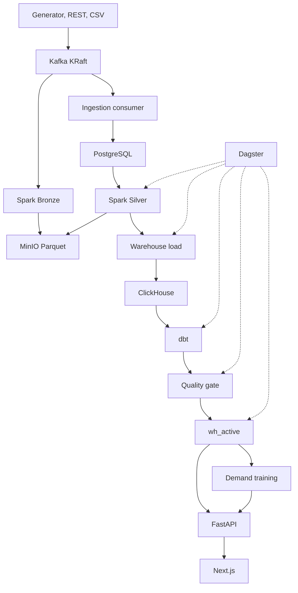

# Architecture overview

TITAN is a local commerce data platform. Synthetic events move through one path:

Dagster orders the jobs. It does not transform rows. dbt builds the models readers query. The API serves analytics only for the publication recorded in both PostgreSQL and `wh_active`.

## What each store means

| Boundary | Guarantee |
| --- | --- |
| Event id | A second delivery of the same `event_id` does not insert another PostgreSQL row. |
| Business key | A new `event_id` with the same order or payment and a different payload is a conflict. It is stored and is not a second accepted order. |
| Kafka | Delivery is at-least-once. Offsets commit after PostgreSQL persistence or quarantine. |
| Spark checkpoint | Streaming progress. It is not the ingestion consumer lag. |
| Bronze | A batch is visible after `bronze_batch_commits`. A partial prefix is not a completed batch. |
| Silver | One published version built from PostgreSQL dispositions. |
| Warehouse | One `wh_active` pointer. Exchange happens after dbt and the blocking quality gate. |
| Forecast | `seasonal_naive` is served because its held-out MAE was lower. The candidate artifact remains. |

There is no end-to-end exactly-once transaction across Kafka, PostgreSQL, MinIO, and ClickHouse.
